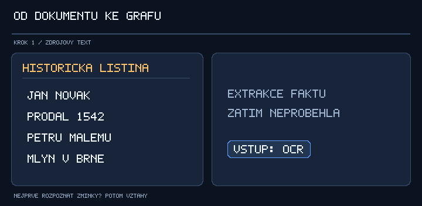
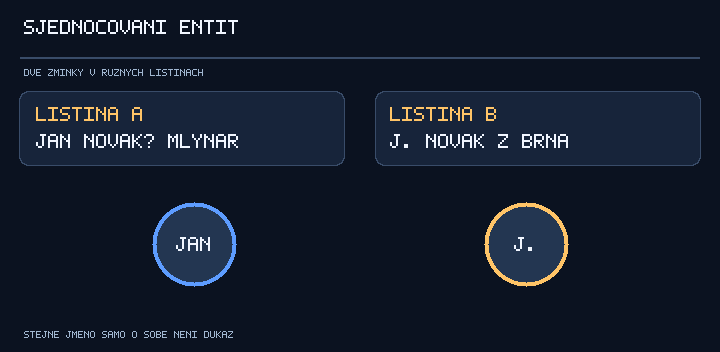
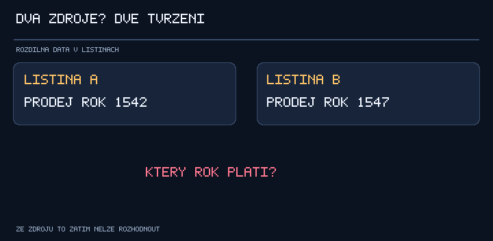

# Analýza znalostních grafů a alternativních reprezentací extrahovaných faktů

> **Diplomová práce:** Extrakce faktů a znalostních grafů z dokumentů  
> **Typ dokumentu:** Plán rešerše, studijní poznámky a podklad pro výběr architektury  
> **Datum založení:** 21. 10. 2026  
> **Stav:** Pracovní dokument – tvrzení označená jako hypotézy nejsou závěry rešerše ani naměřené výsledky.

## Obsah

1. [Cíl analýzy a výzkumné otázky](#1-cíl-analýzy-a-výzkumné-otázky)
2. [Základní pojmy](#2-základní-pojmy)
3. [Proč uvažovat o znalostním grafu](#3-proč-uvažovat-o-znalostním-grafu)
4. [Přehled reprezentací](#4-přehled-reprezentací)
5. [Datové modely znalostních grafů](#5-datové-modely-znalostních-grafů) — včetně [správného zápisu, serializace a validace](#54-správný-zápis-syntaxe-sémantika-a-validace)
6. [Ontologie, sémantika a standardy](#6-ontologie-sémantika-a-standardy)
7. [Specifika faktů extrahovaných z dokumentů](#7-specifika-faktů-extrahovaných-z-dokumentů)
8. [Navrhovaná extrakční pipeline](#8-navrhovaná-extrakční-pipeline)
9. [Návrh datového schématu](#9-návrh-datového-schématu)
10. [Dotazování a konkrétní scénáře použití](#10-dotazování-a-konkrétní-scénáře-použití)
11. [RAG a GraphRAG](#11-rag-a-graphrag)
12. [Kritéria porovnání](#12-kritéria-porovnání)
13. [Návrh experimentu](#13-návrh-experimentu)
14. [Metodika vyhodnocení](#14-metodika-vyhodnocení)
15. [Plán rešerše a práce](#15-plán-rešerše-a-práce)
16. [Otázky na konzultaci a rizika](#16-otázky-na-konzultaci-a-rizika)
17. [Literatura a odkazy](#17-literatura-a-odkazy)
18. [Průběžné hypotézy a šablona závěru](#18-průběžné-hypotézy-a-šablona-závěru)

---

## 1. Cíl analýzy a výzkumné otázky

Vedoucí zadal jako první úkol **podrobnou analýzu znalostních grafů a podobných struktur**. Smyslem není předem předpokládat, že znalostní graf je nejlepší řešení, ale odborně vyhodnotit, **zda pro extrakci faktů z dokumentů přináší dostatečnou přidanou hodnotu** oproti jednodušším způsobům uložení a reprezentace.

### 1.1 Hlavní otázka

> **Které datové a znalostní reprezentace jsou vhodné pro informace extrahované z textových dokumentů a za jakých podmínek se vyplatí vytvářet znalostní graf?**

### 1.2 Dílčí výzkumné otázky

| ID | Výzkumná otázka |
|---|---|
| RQ1 | Co přesně je znalostní graf? Jak se liší od obyčejného grafu a grafové databáze? |
| RQ2 | Jaký je rozdíl mezi RDF a Property Graph modelem? |
| RQ3 | Jaké alternativy existují (SQL, JSON, dokumentové DB, event-centric reprezentace, hypergrafy)? |
| RQ4 | Jak dobře jednotlivé varianty reprezentují entity, vztahy, události a jejich role? |
| RQ5 | Jak zachovat vazbu na zdrojový dokument, důkaz, časovou platnost, nejistotu a konfliktní tvrzení? |
| RQ6 | Jak zajistit identitu entit mezi více dokumenty? |
| RQ7 | Jaké dotazy a následné analýzy mají být nad výsledkem možné? |
| RQ8 | Jak náročné je jednotlivé reprezentace implementovat, měnit a provozovat? |
| RQ9 | Lze přínos grafu prokázat měřitelným experimentem se stejnými daty? |
| RQ10 | Jak mají být znalosti **správně zapisovány**: identifikátory, syntaxe RDF/Turtle/JSON-LD, ontologie, datové typy, provenienční metadata, validace a sémantika? |

### 1.3 Očekávané výstupy této fáze

- **Rešerše:** ověřené odborné zdroje a popis relevantních reprezentací.
- **Požadavky:** typy extrahovaných faktů a scénáře, které s nimi chce systém řešit.
- **Srovnání:** přehled možností, omezení a složitosti jednotlivých přístupů.
- **Praktické příklady:** stejný fakt/událost v JSON, SQL, RDF a Property Graphu.
- **Analýza zápisu:** konkrétní syntaktické ukázky (Turtle, JSON-LD, Cypher), pravidla ontologie, validace a neztrátového převodu mezi reprezentacemi.
- **Návrh pilotu:** jak porovnat vhodnost reprezentací bez zkreslení kvalitou extrakce.
- **Zdůvodněný závěr:** kdy je KG vhodný, případně který model zvolit a proč.

**Důležité:** výsledkem může být i doporučení znalostní graf nepoužít nebo použít hybridní řešení. Takový závěr není neúspěch, pokud vychází z analýzy.

---

## 2. Základní pojmy

### 2.1 Co je Knowledge Graph (KG)?

**Znalostní graf** je reprezentace znalostí o objektech (entitách) a jejich vztazích. Typicky pracuje s uzly, hranami, typy, identifikátory a explicitním významem vztahů. Neexistuje jediná zcela jednotná definice; v literatuře zahrnuje rodinu souvisejících reprezentací (viz Hogan a kol., *Knowledge Graphs*).

Příklad jednoduchých faktů z fiktivní historické listiny:

> „Jan Novák prodal v roce 1542 Petrovi Malému mlýn v Brně.“

```text
(Jan Novák) --PRODAL--> (Mlýn č. 1)
(Petr Malý) --KOUPIL--> (Mlýn č. 1)
(Mlýn č. 1) --NACHÁZÍ_SE_V--> (Brno)
```

**Pozor:** tento jednoduchý obrázek nezachycuje, že prodej proběhl jako **jedna událost**, ve které vystupoval prodávající, kupující, věc, místo a datum. To vede k potřebě komplexnějšího modelování.

#### Animace: od historické listiny ke znalostnímu grafu



*Animace je schematický příklad, nikoliv výstup hotového extraktoru.* Z textu se nejdříve rozpoznají **zmínky o osobách, objektu a místě**. Následně se vytvoří **událost prodeje**, která propojí prodávajícího, kupujícího, předmět, rok a místo. Důležité je nezaměňovat zmínky v textu za jednoznačně identifikované historické entity.


### 2.2 Slovník pojmů

| Pojem | Vysvětlení |
|---|---|
| **Entity** | Konkrétní objekt popisovaného světa: osoba, místo, organizace, předmět. |
| **Mention** | Výskyt entity v textu, například „pan Novák“ na straně 2. |
| **Entity identity** | Rozhodnutí, které zmínky označují stejnou skutečnou entitu. |
| **Relation** | Vztah mezi entitami, např. *osoba vlastní budovu*. |
| **Event** | Událost s účastníky, rolemi, časem a případně místem. |
| **Fact / assertion / claim** | Tvrzení o světě; u dokumentů jde často nejprve o *tvrzení zdroje*, nikoliv ověřenou pravdu. |
| **Evidence** | Konkrétní pasáž, která tvrzení podporuje. |
| **Provenance** | Informace, odkud tvrzení pochází a jak bylo získáno/zpracováno. |
| **Schema** | Definice struktury a omezení dat. |
| **Ontology** | Formálně popsaná doména: třídy, vlastnosti, vztahy a případně logická pravidla. |
| **Knowledge representation** | Způsob, jakým se znalosti formalizují. |
| **Data model** | Způsob organizace dat, např. RDF, relační model, Property Graph. |
| **Serialization** | Konkrétní zápis/přenos dat, např. Turtle, JSON-LD, JSON. |
| **Graph database** | Databáze optimalizovaná pro ukládání a dotazování grafových struktur. |
| **Triplestore** | Úložiště RDF trojic nebo RDF datasetů. |
| **Graph traversal** | Procházení vazeb mezi uzly, např. sousedé či cesta délky N. |
| **Inference / reasoning** | Odvozování nových tvrzení ze schématu a existujících tvrzení. |
| **Entity linking / resolution** | Spojení zmínek se známými entitami, včetně řešení aliasů a duplicit. |
| **Coreference** | Určení, zda různé výrazy v textu odkazují ke stejnému referentu. |
| **NER** | Named Entity Recognition: rozpoznání zmínek o osobách, místech apod. |
| **Relation extraction** | Extrakce vztahů mezi nalezenými entitami. |
| **Event extraction** | Identifikace událostí, jejich účastníků, rolí a atributů. |
| **RAG** | Retrieval-Augmented Generation: získání externích podkladů pro generativní model. |
| **GraphRAG** | Varianta/rodina architektur, které pro retrieval a generování využívají grafové informace. |

### 2.3 Co je a není totéž

- **KG ≠ Neo4j:** KG je reprezentace znalostí; Neo4j je konkrétní grafový databázový systém.
- **KG ≠ RDF:** RDF je jeden z grafových datových modelů, ale existují i jiné.
- **RDF ≠ SPARQL:** RDF je model, SPARQL je dotazovací jazyk.
- **RDF ≠ JSON-LD:** JSON-LD je jedna ze serializací propojených dat.
- **Property Graph ≠ Cypher:** Property Graph je model; Cypher je jeden z dotazovacích jazyků.
- **Graf ≠ automaticky pravdivé znalosti:** chybné informace lze uložit stejně snadno jako správné.
- **KG ≠ GraphRAG:** GraphRAG je možný způsob využití grafových informací, nikoliv definice KG.

---

## 3. Proč uvažovat o znalostním grafu

### 3.1 Potenciální výhody

1. **Propojení informací napříč dokumenty:** různé zmínky mohou odkazovat na jednu osobu nebo místo.
2. **Explicitní vztahy:** lze vyjádřit, kdo s kým souvisí a jak.
3. **Dotazy přes více hran:** přímé i nepřímé vazby mezi osobami, objekty a událostmi.
4. **Flexibilita schématu:** některé grafové modely přirozeněji zachycují různorodé vztahy.
5. **Provenance a kvalifikátory:** při správném modelování lze evidovat zdroj, čas a nejistotu tvrzení.
6. **Sémantická interoperabilita:** zejména RDF může používat standardizované ontologie a externí identifikátory.
7. **Odvozování a kontrola:** některé vztahy lze odvodit nebo kontrolovat podle pravidel.
8. **Vizualizace souvislostí:** užitečná pro průzkum a interpretaci znalostí.

### 3.2 Potenciální nevýhody

1. Složitější návrh modelu a identifikátorů.
2. Nutnost řešit **entity resolution**, jinak vznikají izolované a duplicitní uzly.
3. Riziko propagace chyb extrakce do mnoha vztahů.
4. Náročnější reprezentace neúplných, nejistých či konfliktních tvrzení.
5. Nová infrastruktura, indexování, údržba a integrace s pipeline.
6. Možná vyšší složitost než JSON/SQL u jednoduchých výpisů faktů.
7. Vizualizace sama o sobě nezaručuje lepší kvalitu výsledků.
8. Specializovaná databáze nemusí přinést výkonovou výhodu u každého typu dotazu.

**Hlavní otázka:** Potřebuje uživatel **znalosti propojovat a dotazovat se na souvislosti**, nebo stačí extrahovat sadu dat z jednotlivých dokumentů?

---

## 4. Přehled reprezentací

Zde porovnáváme reprezentace a jejich modelování, nikoliv pouze produkty.

| Reprezentace | Princip | Výhody | Omezení / otázky |
|---|---|---|---|
| **JSON** | Hierarchické objekty a pole | Snadný výstup LLM, validace, přenos | Sdílené entity a vztahy mezi dokumenty vyžadují další návrh |
| **Relační SQL** | Tabulky, klíče a vazby | Integrita, transakce, známý ekosystém | Složité/proměnlivé vztahy mohou vyžadovat více JOINů |
| **Property Graph** | Uzly a hrany s vlastnostmi | Přirozené vícehopové dotazy | Interoperabilita/sémantika závisí na návrhu a engine |
| **RDF Knowledge Graph** | Trojice subjekt–predikát–objekt | Otevřené standardy, ontologie, propojená data | Složitější schéma a kvalifikace tvrzení |
| **Event-centric** | Události jako samostatné objekty | Přirozené zachycení účastníků, rolí, času | Není samostatný storage model; lze realizovat v SQL/RDF/grafu |
| **Claim-centric** | Prvotní jsou tvrzení a jejich důkazy | Provenance, konflikty a revize | Více objektů a vazeb; není samostatný storage model |
| **Hypergraf** | Hrana může spojovat více uzlů | Přímé n-ární vztahy | Méně rozšířený ekosystém; alternativou je uzel události |
| **Hybridní model** | Např. SQL pro tvrzení + grafová projekce | Oddělení zdroje pravdy a vyhledávání | Synchronizace a dvojnásobná správa |
| **Vektorový index** | Vektory významové podobnosti | Sémantické vyhledávání pasáží | Nenahrazuje explicitní vztahy a doklady tvrzení |

**Poznámka:** event-centric a claim-centric jsou především **způsoby konceptuálního modelování**; mohou být realizovány ve více datových modelech. JSON může být meziformátem pro každý z nich.

### 4.1 JSON – příklad

```json
{
  "event_type": "sale",
  "year": 1542,
  "seller": "Jan Novák",
  "buyer": "Petr Malý",
  "object": "mlýn",
  "place": "Brno",
  "source_document": "doc-001"
}
```

**Otázka:** Jak snadno vyhledat *všechny* obchody jedné osoby, pokud je v jiných dokumentech uvedena pod odlišnými jmény?

### 4.2 Relační databáze – příklad

Možné tabulky:

```text
documents(id, title, ocr_version, ...)
entities(id, entity_type, canonical_name, ...)
mentions(id, document_id, text, start_offset, end_offset, ...)
mention_entity_links(mention_id, entity_id, confidence, ...)
events(id, event_type, date_from, date_to, ...)
event_roles(event_id, entity_id, role, ...)
assertions(id, subject_id, predicate, object_id, status, ...)
evidence(assertion_id, document_id, mention_id, ...)
```

**Důležité:** SQL umí reprezentovat i složité vztahy. Rekurzivní CTE umožňují grafové průchody; grafová databáze není jedinou možností.

### 4.3 Event-centric – příklad

```text
                 (Prodej #1)
                  /   |   \
                 /    |    \
       prodávající  kupující  předmět
              |      |        |
           (Jan)   (Petr)   (Mlýn)

   datum: 1542
   místo: Brno
   zdroj: doc-001
```

Tento model brání tomu, aby se prodej chápal jen jako izolované dvojice hran: všechny role a atributy patří k **jedné události**.

---

## 5. Datové modely znalostních grafů

### 5.1 RDF – Resource Description Framework

RDF používá trojice **subject – predicate – object** (subjekt, predikát, objekt). Zdroj a predikát jsou zpravidla identifikovány pomocí IRI.

```text
(person:jan_novak, rdf:type, class:Person)
(person:jan_novak, rel:livesIn, place:brno)
(place:brno, rdf:type, class:Place)
```

#### Co nastudovat

- RDF trojice a RDF datasety.
- IRI, literály, blank nodes, datové typy a jazyky.
- **Named graphs** (oddělené grafy v datasetu; modelování kontextu).
- Serializace: Turtle, N-Triples, TriG, JSON-LD.
- **SPARQL** – dotazování.
- **RDFS / OWL** – ontologie a inference.
- **SHACL** – kontrola omezení dat.
- **RDF 1.2 / triple terms** – novější způsoby zachycení metadat o trojicích; ověřit status a podporu v konkrétním úložišti.
- Provenance: explicitní uzly tvrzení, named graphs, PROV-O, alternativní modely.

**Výhody:** standardizace a integrace s existujícími ontologiemi. **Nevýhody:** netriviální návrh ontologie a modelování metadat jednotlivých tvrzení, otázka podpory standardů nástroji.

### 5.2 Property Graph

**Uzel** reprezentuje entitu a **hrana** vztah. Uzly i hrany mohou mít vlastnosti.

```text
(:Person {id: "person-1", name: "Jan Novák"})
    -[:OWNED {from: 1540, to: 1550}]->
(:Property {id: "mill-1", type: "mill"})
```

#### Co nastudovat

- Labels, relationship types, node/edge properties.
- Identifikátory a uniqueness constraints.
- Indexy, traversal, shortest path a další dotazy.
- Cypher vs. standard **GQL (ISO/IEC 39075:2024)**; nejsou automaticky totožné.
- Neo4j jako *příklad implementace*, ne jako definici modelu.
- Reprezentaci zdroje a konfliktních tvrzení (atribut hrany vs. uzel tvrzení).

**Výhody:** srozumitelné modelování vazeb a grafové dotazy. **Nevýhody:** sémantika může být specifická pro aplikaci, datový model a dostupné funkce se mohou lišit mezi systémy.

### 5.3 Přímé hrany vs. tvrzení jako samostatné uzly

**Přímá hrana:**

```text
(Person A) --OWNED--> (Mill B)
```

**Reifikované tvrzení / claim-centric přístup:**

```text
(Document #1) --SUPPORTS--> (Assertion #1)
                              |    |     |
                           subject rel object
                              |    |     |
                          (Person) owned (Mill)
```

Zvolená reprezentace by měla zvládnout situaci, kdy **dva dokumenty tvrdí různé informace o téže věci**, aniž by jeden z nich systém automaticky zahodil.

**Nastudovat rozdíl:** událost je popisem toho, co se podle zdroje stalo; tvrzení je záznam o tom, co zdroj o události říká. Událost i tvrzení mohou být samostatné objekty.

### 5.4 Správný zápis: syntaxe, sémantika a validace

Nestačí porovnat **tvar grafu (uzly, hrany, trojice)**. Pro diplomku je nutné analyzovat také **způsob zápisu konkrétních znalostí**, jeho význam a to, jak lze zapsané znalosti validovat a neztrátově exportovat.

**Samostatná podrobná analýza:** [Zápis znalostního grafu – syntaxe, sémantika, serializace a validace](docs/knowledge_graph_serialization.md). Obsahuje skutečné příklady jedné historické události v **RDF/Turtle**, **JSON-LD** a **Property Graph/Cypher**, ukázku **SHACL**, kontrast přímé hrany a uzlu tvrzení i příklad dvou rozporných zdrojů.

Rozlišovat zejména:

| Vrstva | Příklad otázky | Konkrétní téma |
|---|---|---|
| Konceptuální a datový model | Co je entita, zmínka, událost a tvrzení? | RDF vs. Property Graph, event/claim-centric |
| Syntaxe a serializace | Jak se informace přesně zapisuje? | Turtle, TriG, JSON-LD, vlastní JSON, import přes Cypher |
| Identita a sémantika | Co **znamená** daný predikát a jak poznáme tentýž objekt? | Stabilní IRI/ID, typy, ontologie, význam vztahů |
| Datové typy a čas | Jak zachováme rok, interval, jazyk a neurčitost? | `xsd:gYear`, jazykové literály, časové kvalifikátory |
| Provenance a rozpory | Jak doložit a případně opravit extrahovaný údaj? | Dokument, pasáž, verze OCR, samostatná tvrzení |
| Validace | Je zápis nejen parsovatelný, ale i doménově správný? | RDF parser, SHACL, JSON Schema, DB constraints, evidence |
| Přenositelnost | Přenese se celý význam mezi formáty a úložišti? | RDF ↔ JSON-LD, mapování RDF ↔ Property Graph |

**Pozor:** JSON je syntaxe, RDF a Property Graph jsou datové modely a Neo4j/PostgreSQL jsou úložiště. Srovnávat tyto kategorie napřímo by zkreslilo výsledek analýzy.

**Kontrolní otázka pro experiment:** Lze z grafu bez ztráty zrekonstruovat *kdo podle kterého zdroje vykonal jakou roli v události, kdy, s jakou nejistotou a s jakou konkrétní textovou evidencí*?

---

## 6. Ontologie, sémantika a standardy

| Standard / model | K čemu slouží | Priorita |
|---|---|---|
| RDF | Reprezentace trojic a grafových dat | Vysoká |
| SPARQL | Dotazy nad RDF | Vysoká |
| RDFS | Základní typy a schémata RDF | Vysoká |
| OWL 2 | Formální ontologie, pravidla a inference | Střední |
| SHACL | Validace omezení RDF grafu | Vysoká pro RDF |
| PROV-O | Provenance: původ a zpracování znalostí | Vysoká |
| JSON-LD | JSON serializace propojených dat | Střední |
| GQL | Standardizovaný jazyk pro property grafy | Střední |
| **CIDOC CRM** | Doménový model pro kulturní dědictví a historické události | **Velmi vysoká** |
| SEM (Simple Event Model) | Obecný model událostí | Střední |
| TEI / ALTO / PAGE XML | Struktura textů, anotace a OCR | Podle dat |
| SKOS | Slovníky a taxonomie | Doplňková |

### 6.1 CIDOC CRM

**CIDOC Conceptual Reference Model** je zvlášť zajímavý pro historické dokumenty, protože podporuje modelování osob, míst, objektů, časových intervalů a událostí.

Prozkoumat:

- jak modeluje **událost**, její účastníky, role, místo a čas;
- jak rozlišuje historické objekty a historická tvrzení;
- zda zvolená podmnožina tříd dokáže vyjádřit fakta z českých dokumentů;
- zda není pro rozsah diplomky použití celé ontologie příliš komplikované;
- zda stačí její principy převzít do menšího doménového schématu.

### 6.2 Open-world a closed-world předpoklady

V otevřeném světě **neznalost tvrzení neznamená jeho nepravdivost**. U historických zdrojů je to zásadní: neexistence zápisu o vlastnictví ještě nedokazuje, že osoba danou věc nevlastnila.

### 6.3 Ontologie vs. validace

**OWL** může vyjadřovat logickou sémantiku a umožňovat inferenci. **SHACL** se používá pro validaci RDF dat vzhledem k omezením. Tato dvě použití není vhodné zaměňovat.

---

## 7. Specifika faktů extrahovaných z dokumentů

### 7.1 Historická čeština a OCR

Nutné zvážit:

- rozdíly historického a současného pravopisu;
- starší názvy měst, přezdívky, tituly a proměnlivé podoby jmen;
- chyby OCR, poškozený text, ligatury a záměny číslic;
- složitou větnou stavbu a nejednoznačné formulace;
- kombinaci češtiny s jinými jazyky;
- ztrátu rozvržení stránky a souvislosti při prostém převodu skenu na text;
- rozdíl mezi **původní podobou textu** a jeho **normalizovanou interpretací**.

Při změně OCR je nutné verzovat text. Samotný offset typu `start: 400, end: 420` jinak přestane spolehlivě odkazovat na původní pasáž.

### 7.2 Entity resolution

Příklad:

```text
Listina A: „Jan Novák, mlynář“
Listina B: „J. Novák z Brna“
Listina C: „Jan Novák, purkmistr“
```

Jsou to tři zmínky o jedné osobě, dvě osoby, nebo tři různé osoby? Příjmení ani město samy o sobě nestačí.

Prozkoumat: NER, coreference, record linkage, entity linking, deduplikaci, aliasy, nejisté propojení a možnost **vrátit chybné sloučení**.

#### Animace: sjednocení zmínek o stejné osobě



Při propojení záznamů **nestačí shodné nebo podobné jméno**. Algoritmus musí zvážit další důkazy (kontext, role, dataci, místo apod.) a případnou nejistotu zachovat. Animace ukazuje *možné sloučení po ověření*; v reálných datech mohou dvě podobné zmínky označovat **různé osoby**.


### 7.3 Provenance a evidence

Každý výsledek by ideálně obsahoval:

- identifikátor původního dokumentu a jeho verzi;
- stránku a konkrétní úryvek textu, případně pozici na skenu;
- verzi OCR;
- model/prompt/verzi extraktoru;
- stav validace nebo lidské kontroly;
- historii oprav a odvození.

**Důvod:** Lze zpětně odpovědět „Proč si systém myslí, že tato osoba vlastnila tento mlýn?“

### 7.4 Nejistota a rozpory

Příklad: Dokument A uvádí rok 1542, dokument B rok 1547. Správná reprezentace má obě tvrzení zachovat a oddělit jejich zdroje.

Rozlišovat:

- nejistotu OCR;
- nejistotu rozpoznání entity;
- nejistotu extrahovaného vztahu;
- neurčitost ve zdroji („údajně“, „asi“);
- konflikt mezi zdroji;
- pravdivost tvrzení vs. jeho věrnou extrakci.

**Pozor:** confidence skóre modelu nemusí být kalibrovaná pravděpodobnost správnosti. Vhodná je evidence, validace a případně kalibrace.

#### Animace: jak zacházet s rozpornými zdroji



Pokud listina A uvádí rok **1542** a listina B rok **1547**, systém by neměl bez dalších důkazů jednu variantu prohlásit za pravdivou. Model *claim-centric* uchová **obě tvrzení odděleně**, spolu s jejich zdroji a stavem ověření. Konečné rozhodnutí může vyžadovat další prameny či lidskou revizi.


### 7.5 Časové vztahy

Uvažovat alespoň čtyři různé časy:

1. **čas události** – například prodej v roce 1542;
2. **valid time** – období, během něhož vlastnictví platilo;
3. **čas vzniku dokumentu** – kdy byla listina napsána;
4. **transaction time** – kdy byla informace zaznamenána v systému.

K tomu přibližné intervaly, neurčené konce, nepřesné datování a historické kalendáře.

### 7.6 Životní cyklus tvrzení

Co když dojde k opravě OCR, změně modelu, ruční revizi nebo přidání nového dokumentu? Rozlišit:

- původní extrakci;
- její nové verze;
- schválení/odmítnutí;
- konsolidované znalosti nad více tvrzeními;
- možnost přepočítat grafovou projekci.

---

## 8. Navrhovaná extrakční pipeline

> **Vizualizace jednotlivých kroků:** [Animace extrakce a vytvoření grafu](#animace-od-historické-listiny-ke-znalostnímu-grafu) v části 2.1. Animace zjednodušuje pořadí kroků pro názornost, není povinnou architekturou systému.


```text
PDF / sken / digitální dokument
               |
         OCR (je-li třeba)
               |
       struktura dokumentu
   (strany, odstavce, offsety)
               |
     čištění a segmentace
               |
          NER / zmínky
               |
   coreference / entity resolution
               |
    extrakce relací a událostí
               |
       normalizace hodnot
               |
      validace + provenance
               |
   uložení zdrojových tvrzení
               |
    konsolidace / propojení
               |
    SQL / JSON / RDF / graf
               |
     dotazování / analýza
```

**Poznámka:** Některé kroky lze dělat jedním LLM pomocí strukturovaného výstupu, jindy je vhodnější pipeline. Tato fáze práce má posoudit **vhodnost reprezentace**, nikoliv ještě volit optimální LLM.

### 8.1 Co nastudovat pro extrakci

- Named Entity Recognition (NER).
- Relation Extraction (RE).
- Event Extraction (EE).
- Document-level a cross-document information extraction.
- Structured outputs, JSON Schema a constrained decoding.
- Zero-shot vs. few-shot prompting.
- Multi-stage vs. end-to-end pipeline.
- Postprocessing, normalizace a schématová validace.
- Hallucinations, unsupported assertions, kontrola proti důkazu.
- Human-in-the-loop anotace a kontrola.

### 8.2 Neoddělovat extrakci od její kvality

Chyba OCR se může přenést do NER, entity linking i znalostního grafu. Graf **sám o sobě nezlepší správnost extrakce**. Při hodnocení je vhodné srovnávat reprezentace na **identických ručně kontrolovaných faktech**.

---

## 9. Návrh datového schématu

### 9.1 Základní typy

| Objekt | Příklad | Co musí obsahovat |
|---|---|---|
| Document | Listina č. 123 | ID, metadata, OCR/verze, umístění |
| Mention | „pan Novák“ | Dokument, rozsah textu, stránka, doslovná podoba |
| Entity | osoba Jan Novák | ID, typ, kanonické jméno, aliasy |
| Relation | vlastní | Typ, účastníci, platnost |
| Event | prodej | ID, druh události, role, čas, místo |
| Assertion | dokument tvrdí vztah | ID, význam tvrzení, stav, zdroj |
| Evidence | textová pasáž | Dokument, offset/verze, případně souřadnice |
| Entity link | zmínka → entita | Stav propojení, skóre, evidence |

### 9.2 Kanonický meziformát (návrh)

**Příklad je pouze ilustrativní, nikoliv schválené schéma projektu.**

```json
{
  "assertion_id": "a-0001",
  "subject_id": "person-001",
  "predicate": "seller_in",
  "object_id": "sale-001",
  "source": {
    "document_id": "doc-001",
    "page": 2,
    "text": "Jan Novák prodal Petrovi Malému mlýn",
    "span_start": 101,
    "span_end": 139,
    "text_version": "ocr-v1"
  },
  "temporal": {
    "start": "1542",
    "end": null,
    "precision": "year"
  },
  "confidence": {
    "score": 0.85,
    "calibrated": false
  },
  "review_status": "unreviewed",
  "extractor": {
    "name": "example-model",
    "version": "example-version"
  }
}
```

Smyslem meziformátu je oddělit **výstup extrakce** od **konkrétního úložiště**. Jeden záznam může být následně namapován do SQL, RDF nebo Property Graphu.

### 9.3 Otázky k návrhu

- Jaké ID přidělovat zmínkám, entitám, událostem a tvrzením?
- Má mít jeden vztah více zdrojů, nebo každý zdroj vlastní tvrzení?
- Která pole jsou povinná a která volitelná?
- Jak řešit chybějící, neurčitá či sporná data?
- Jak oddělit neověřené a potvrzené extrakce?
- Jak upravit schéma při objevení nové třídy událostí?
- Jak zajišťovat reverzibilitu chybného entity linking?

---

## 10. Dotazování a konkrétní scénáře použití

Před výběrem databáze je nutné určit, jaké dotazy budou užitečné. Bez reálných scénářů nelze vyhodnotit přidanou hodnotu grafu.

| ID | Požadavek | Prověřovaná vlastnost |
|---|---|---|
| Q1 | Jaké osoby se vyskytují v dokumentu D? | Jednoduchý výpis |
| Q2 | Ve kterých dokumentech se objevuje osoba P? | Identita napříč dokumenty |
| Q3 | Které objekty vlastnila P mezi roky X a Y? | Časově omezené vztahy |
| Q4 | Kdo prodal co komu a kdy? | Event-centric model |
| Q5 | Jakými vztahy jsou propojeny dvě osoby? | Vícehopové grafové dotazy |
| Q6 | Které dokumenty si odporují ohledně vlastnictví? | Konflikty a provenance |
| Q7 | Jaké tvrzení dokládají alespoň dva nezávislé zdroje? | Evidence aggregation |
| Q8 | Jak se měnil majitel konkrétního objektu v čase? | Temporal model |
| Q9 | Kdo byl spojen s institucí přes společné události? | Propojení více typů entit |
| Q10 | Ukaž pasáž zdrojového textu dokládající odpověď. | Auditovatelnost |
| Q11 | Jak se odpovědi změní po opravě chybně spojených osob? | Aktualizace a konzistence |
| Q12 | Vyhledej související události do hloubky tří vztahů. | Traversal a dotazovací výkon |

### 10.1 Ilustrace téhož vztahu v různých dotazovacích jazycích

**SQL** (předpoklad tabulky `ownership` a celých roků):

```sql
SELECT property_id FROM ownership WHERE person_id = 'person-001' AND valid_from <= 1542 AND (valid_to IS NULL OR valid_to >= 1542);
```

**Cypher** (předpoklad hrany `OWNED` s vlastnostmi):

```cypher
MATCH (p:Person {id: 'person-001'})-[r:OWNED]->(x:Property)
WHERE r.valid_from <= 1542 AND (r.valid_to IS NULL OR r.valid_to >= 1542)
RETURN x.id;
```

**SPARQL** (zjednodušený přímý vztah, bez časového omezení):

```sparql
PREFIX ex: <https://example.org/kg/>
SELECT ?property WHERE { ex:person-001 ex:owned ?property . }
```

Tyto ukázky **nejsou sémanticky plně ekvivalentní** (SPARQL zde nefiltruje čas) a neslouží jako benchmark. Pro experiment je třeba definovat stejnou sémantiku pro každou variantu.

---

## 11. RAG a GraphRAG

### 11.1 RAG

*Retrieval-Augmented Generation* vyhledá relevantní externí podklady (např. textové pasáže) a předá je jazykovému modelu jako kontext. Základní pipeline:

```text
uživatelský dotaz → vyhledání pasáží → LLM → odpověď
```

### 11.2 GraphRAG

GraphRAG označuje přístupy, které při vyhledávání, agregaci nebo plánování kontextu využívají grafovou strukturu (např. entity a jejich vztahy).

```text
uživatelský dotaz → identifikace entit → průchod grafem
                   → související důkazy → LLM → odpověď
```

**Nastudovat:** kdy se vyplatí explicitní procházení vztahů, co lze získat běžným fulltextem nebo embeddingy, a jak poctivě měřit kvalitu odpovědí. **GraphRAG není důvod používat KG automaticky**; pokud výsledná aplikace nebude generovat odpovědi, může být jen okrajovou oblastí rešerše.

---

## 12. Kritéria porovnání

### 12.1 Kvalitativní srovnání – pouze pracovní hypotéza

| Kritérium | JSON | SQL / PostgreSQL | Property Graph | RDF |
|---|---|---|---|---|
| Jednoduchá extrakce jednoho dokumentu | Velmi dobrá | Dobrá | Nutné mapování | Nutné mapování |
| Propojování sdílených identit | Nutno doplnit | Dobré při správném schématu | Přirozené | Přirozené |
| Vícehopové dotazy | Obtížnější | Možné, včetně rekurze | Přirozené | Přirozené |
| N-ární události | Vnořené objekty | Tabulka rolí | Uzel události | Uzel události |
| Provenance a rozpory | Musí se navrhnout | Musí se navrhnout | Musí se navrhnout | Musí se navrhnout |
| Formální ontologie | Není zabudovaná | Není zabudovaná | Závisí na řešení | Silný standardizovaný ekosystém |
| Integrita dat | Závisí na úložišti | Silná | Závisí na engine | Závisí na engine |
| Jednoduchost začátku | Obvykle vysoká | Obvykle vysoká | Střední | Střední až nižší |

Tato matice **není závěr rešerše**. Hodnocení vychází z obecných vlastností a musí být zpřesněno podle konkrétního schématu a způsobu použití.

### 12.2 Dimenze, které skutečně měřit

- **Pokrytí:** které požadované typy faktů a událostí lze uložit bez ztráty významu?
- **Věrnost:** lze rekonstruovat přesně to, co tvrdil zdroj?
- **Provenance:** lze odpověď doložit pasáží a verzí původního dokumentu?
- **Nejistota:** lze uložit alternativy a nejasnosti bez chybného sjednocení?
- **Dotazovatelnost:** které předdefinované dotazy lze vyjádřit a jak složitě?
- **Udržovatelnost:** kolik práce znamená nová třída entity, vztahu nebo události?
- **Aktualizovatelnost:** lze snadno opravit spojení entit, opravit OCR a přepočítat projekci?
- **Výkon:** doba dotazu, vložení, aktualizace, nároky na paměť a úložiště.
- **Interoperabilita:** možnost exportu, použití standardů, ontologií a propojených dat.
- **Náklady:** složitost implementace, nutné knihovny, databáze, administrace a provoz.

---

## 13. Návrh experimentu

### 13.1 Cíl

Na **stejné množině ověřených tvrzení** zjistit, které reprezentace jsou pro plánované scénáře vhodné. Oddělit hodnocení **reprezentace** od hodnocení **kvality extrakčního modelu**.

### 13.2 Malý dataset

Orientačně 20–40 dokumentů (skutečný rozsah upřesnit s vedoucím). Pokud korpus zatím není k dispozici, lze nejprve vytvořit **syntetické příklady**. Konečné vyhodnocení musí ale reflektovat reálné dokumenty a chyby OCR.

Povinné testovací situace:

1. Jednoznačný fakt v jednom dokumentu.
2. Více odlišných jmen téže osoby.
3. Dvě různé osoby se stejným jménem.
4. Událost se třemi a více rolemi.
5. Částečně známé datum či interval.
6. Dva navzájem rozporné zdroje.
7. OCR chyba v datu nebo jméně.
8. Tentýž fakt doložený více dokumenty.
9. Ruční oprava chybného entity linking.
10. Dotaz s povinným odkazem na původní důkaz.

### 13.3 Kandidátní implementace

- **A – JSON / JSON Schema:** nejjednodušší extrakční baseline.
- **B – PostgreSQL:** relační schéma, případně JSONB.
- **C – Property Graph:** příklad implementace v Neo4j nebo podobném engine.
- **D – RDF:** RDFLib pro rychlý prototyp; pro měření databázového výkonu reálný RDF engine.

Není nutné implementovat všechny systémy produkčně. **Srovnání datových modelů** lze provést i bez kompletního nasazení; srovnání databázového výkonu ale vyžaduje skutečné databáze.

### 13.4 Konkrétní experimentální úkoly

- [ ] Připravit kanonický formát tvrzení a doménové schéma.
- [ ] Ručně ověřit malý gold standard entit, vztahů, událostí a důkazů.
- [ ] Namapovat identickou množinu faktů do 2–4 reprezentací.
- [ ] Provést stejné typy dotazů Q1–Q12 s ekvivalentním významem.
- [ ] Prověřit správnost, úplnost a dohledatelnost výsledků.
- [ ] Otestovat přidání nového dokumentu, opravu OCR a opravu identity.
- [ ] Zaznamenat pracnost vytvoření a změny schématu.
- [ ] Případně měřit importní čas, latenci dotazů, velikost dat a RAM.
- [ ] Sepsat omezení měření a neoprávněné generalizace.

### 13.5 Férové podmínky

- Stejná vstupní fakta, stejné ID a stejná očekávaná odpověď.
- Stejné významy vztahů, včetně časové platnosti.
- Zdokumentované indexování, verze knihoven, hardware a nastavení.
- Opakování měření; rozlišovat cold/warm cache.
- Nezaměňovat měření doby grafového dotazu s dobou extrakce LLM.
- Malý pilot neprokazuje chování na milionech entit.

---

## 14. Metodika vyhodnocení

### 14.1 Kvalita extrakce (pokud bude součástí experimentu)

- **Precision** = TP / (TP + FP)
- **Recall** = TP / (TP + FN)
- **F1** = 2 × Precision × Recall / (Precision + Recall)

Hodnotit zvlášť **NER**, **relation extraction**, **event extraction** a případně **entity linking**. Zjišťovat rozdíl mezi falešným sloučením entit a neprovedeným sloučením. U tvrzení kontrolovat doložitelnost a věrnost zdroji.

### 14.2 Kvalita reprezentace

Pro různé reprezentace měřit zejména:

1. úplnost uložených informací a možnost rekonstrukce tvrzení;
2. zachování původu a důkazů;
3. podporu konfliktů a časových údajů;
4. správnost odpovědí na sadu definovaných dotazů;
5. složitost změn schématu a aktualizací;
6. výkon a náklady za stejných podmínek.

**Zásadní:** vyšší F1 extrakce po zavedení grafu neprokazuje výhodu datového modelu, pokud se současně změnil LLM, prompt nebo způsob předzpracování.

### 14.3 Návrh vážené rozhodovací matice

Váhy níže jsou **výchozí návrh pro diskusi**, nikoliv definitivní preference vedoucího.

| Kritérium | Návrh váhy |
|---|---:|
| Věrná reprezentace entit, událostí a tvrzení | 20 % |
| Provenance, nejistota a konflikty | 20 % |
| Požadované dotazy a jejich vyjádřitelnost | 20 % |
| Entity resolution a integrace mezi dokumenty | 15 % |
| Náročnost implementace a údržby | 10 % |
| Interoperabilita a standardy | 10 % |
| Výkon v očekávaném měřítku | 5 % |
| **Celkem** | **100 %** |

Každému hodnocení 1–5 přiřadit **zdůvodnění a důkaz**. Nedoložené body označit jako „neověřeno“; nevyplňovat je domněnkami. Provést i jednoduchou citlivostní analýzu vah.

---

## 15. Plán rešerše a práce

### Fáze A: základy reprezentace znalostí – **P0**

- [ ] Přečíst základní survey *Knowledge Graphs* (Hogan et al.).
- [ ] Vysvětlit všechny důležité termíny a jejich rozdíly.
- [ ] Zvládnout RDF triple / IRI / named graph.
- [ ] Ověřit **skutečnou RDF syntaxi** na Turtle a JSON-LD, datové typy a smysl IRI/ontologie.
- [ ] Zvládnout Property Graph / uzel / hranu / atribut.
- [ ] Na jednom příkladu porovnat RDF, Property Graph a SQL.
- [ ] Pochopit datový model vs. serializaci vs. engine.

**Výstup:** shrnutí konceptů a několik srozumitelných diagramů.

### Fáze B: alternativy a jejich omezení – **P0**

- [ ] JSON, JSON Schema, JSONB.
- [ ] Relační schéma, SQL JOIN, rekurzivní dotazy.
- [ ] RDF + SPARQL.
- [ ] Property Graph + Cypher/GQL.
- [ ] Prostudovat syntaxe a pravidla zápisu podle [analýzy serializace a validace](docs/knowledge_graph_serialization.md).
- [ ] U stejné události porovnat Turtle, JSON-LD a zápis/import Property Graphu; ověřit převod bez ztráty významu.
- [ ] Event-centric a claim-centric návrh.
- [ ] Hypergraf a hybridní model.

**Výstup:** srovnávací matice a model stejných tvrzení v několika přístupech.

### Fáze C: kvalita znalostí a historické dokumenty – **P0**

- [ ] Historická čeština a problémy OCR.
- [ ] Entity resolution, aliasy, duplicity, nejisté identity.
- [ ] Provenance a PROV-O.
- [ ] Definovat a ověřit pravidla zápisu zdrojových tvrzení, typů dat, důkazů a schématové validace (např. SHACL).
- [ ] Konfliktní a nejistá tvrzení.
- [ ] Časové údaje a intervaly.
- [ ] CIDOC CRM / event-centric modely.
- [ ] Přesná vazba tvrzení na důkaz v dokumentu.

**Výstup:** návrh reprezentace alespoň tří složitějších historických situací.

### Fáze D: extrakční metody – **P1**

- [ ] NER, relation extraction, event extraction.
- [ ] Document-level a cross-document IE.
- [ ] Structured outputs a validace proti schématu.
- [ ] LLM, few-shot, multi-stage pipeline, postprocessing.
- [ ] Kontrola halucinací a evidence.
- [ ] Human-in-the-loop.

**Výstup:** návrh budoucí pipeline a seznam očekávaných chyb.

### Fáze E: použití a vyhodnocení – **P1**

- [ ] Vybrat s vedoucím skutečné use cases.
- [ ] Popsat reprezentativní dotazy.
- [ ] Provést pilot se stejnými fakty.
- [ ] Porovnat kvalitu modelování a dotazování.
- [ ] Zpracovat výsledky a omezení.
- [ ] Formulovat doporučenou architekturu.

**Výstup:** závěr založený na požadavcích a ověřitelných argumentech.

### Orientační harmonogram

| Období | Zaměření | Výstup |
|---|---|---|
| 1. týden | Základy KG/RDF/Property Graph + alternativy | Slovník, diagramy, první porovnání |
| 2. týden | Provenance, historická data, události, ontologie | Doménový model a analýza rizik |
| 3. týden | Srovnávací dotazy / případný pilot | Pozorování a základní měření |
| 4. týden | Syntéza a konzultace s vedoucím | Zdůvodněné doporučení |

*Časy jsou pouze orientační; prioritou je rozsah požadovaný vedoucím.*

### Doporučená struktura dalších souborů v repozitáři (návrh, zatím neexistují)

```text
knowledge_graphs_analysis.md
README.md
docs/
  literature_review.md
  requirements.md
  representation_comparison.md
  evaluation_plan.md
examples/
  sample_assertions.json
  queries.sql
  queries.cypher
  queries.rq
experiments/
  README.md
```

---

## 16. Otázky na konzultaci a rizika

### 16.1 Otázky pro vedoucího

1. Má být výsledkem pouze **extrakce faktů**, nebo i **analýza a dotazování mezi dokumenty**?
2. Jaké konkrétní dokumenty a jaký rozsah korpusu budou k dispozici?
3. Jaké typy entit, vztahů a událostí jsou nejdůležitější?
4. Je prioritou **historický jazyk**, nebo obecné řešení pro různé dokumenty?
5. Potřebujeme interoperabilitu s existujícími ontologiemi / Linked Open Data?
6. Je nějaká preferovaná technologie (RDF/Neo4j/PostgreSQL), nebo je výběr otevřený?
7. Jak důležité jsou časová platnost, provenance a konfliktní tvrzení?
8. Je možné získat expertně ověřená data pro vyhodnocení?
9. Požaduje se v této fázi pouze literární rešerše, nebo i experimentální prototyp?
10. Jaký konkrétní výstup má být připraven na další konzultaci?

### 16.2 Rizika a opatření

| Riziko | Možný dopad | Opatření |
|---|---|---|
| Předčasná volba grafu | Složitost bez přínosu | Nejprve porovnat scénáře a baseline |
| Chybné entity linking | Falešné vazby | Evidence, skóre, ruční opravy a reverzibilita |
| Ztracený původ tvrzení | Neověřitelné výsledky | Povinné evidence a verzování |
| Chyby OCR | Nesprávná extrakce | Reálné testy a vazba na sken |
| Halucinace LLM | Nepodložené znalosti | Důkaz pro každé tvrzení a validace |
| Příliš složitá ontologie | Nadměrné implementační náklady | Začít menším schématem |
| Nesrovnatelná data | Zkreslený závěr | Společný meziformát a gold standard |
| Nejasná sada dotazů | Nelze doložit přínos | Use cases definovat před benchmarkem |
| Licence a citlivá data | Omezené zveřejňování | Zkontrolovat podmínky korpusu |
| Proměnlivé API/LLM | Špatná reprodukovatelnost | Verzovat modely, prompty a konfigurace |

### 16.3 Co zatím není nutné

- Implementovat produkční systém.
- Trénovat vlastní model.
- Vytvářet rozsáhlou ontologii od nuly.
- Implementovat GraphRAG bez požadavku na jeho použití.
- Měřit desítky databází.
- Tvrdit, že jedna varianta je obecně nejlepší.

---

## 17. Literatura a odkazy

V této části jsou **výchozí studijní zdroje**, nikoliv automaticky prostudovaná a kriticky vyhodnocená literatura. U každé položky během rešerše doplnit přesnou bibliografii, hlavní zjištění, omezení a relevanci pro diplomku.

### 17.1 Základní literatura

1. **Hogan, A. et al. – Knowledge Graphs.** ACM Computing Surveys (2021). Přehled konceptů, modelů, dotazování a konstrukce KG. [arXiv:2003.02320](https://arxiv.org/abs/2003.02320)
2. **W3C – RDF 1.1 Concepts and Abstract Syntax.** Datový model RDF. <https://www.w3.org/TR/rdf11-concepts/>
3. **W3C – SPARQL 1.1 Query Language.** Dotazy nad RDF. <https://www.w3.org/TR/sparql11-query/>
4. **W3C – RDF Schema 1.1.** Typy, třídy a vlastnosti RDF. <https://www.w3.org/TR/rdf-schema/>
5. **W3C – OWL 2 Overview.** Formální ontologie. <https://www.w3.org/TR/owl2-overview/>
6. **W3C – SHACL.** Validace RDF dat. <https://www.w3.org/TR/shacl/>
7. **W3C – PROV-O: The PROV Ontology.** Původ znalostí. <https://www.w3.org/TR/prov-o/>
8. **W3C – JSON-LD 1.1.** Propojená data v JSON. <https://www.w3.org/TR/json-ld11/>
9. **ISO/IEC 39075:2024 – GQL.** Standardizovaný grafový dotazovací jazyk. <https://www.iso.org/standard/76120.html>
10. **CIDOC CRM.** Ontologie pro kulturní dědictví. <https://cidoc-crm.org/>
11. **W3C RDF 1.2 Concepts.** Novější RDF specifikace – při citaci ověřit její aktuální status. <https://www.w3.org/TR/rdf12-concepts/>

### 17.2 Extrakce, události a využití grafu

12. **Yao, Y. et al. – DocRED: A Large-Scale Document-Level Relation Extraction Dataset.** ACL 2019. [ACL Anthology](https://aclanthology.org/P19-1074/)
13. **van Hage, W. R. et al. – Design and use of the Simple Event Model (SEM).** Web Semantics (2011). [DOI](https://doi.org/10.1016/j.websem.2011.03.003)
14. **Edge, D. et al. – From Local to Global: A Graph RAG Approach to Query-Focused Summarization.** 2024. [arXiv:2404.16130](https://arxiv.org/abs/2404.16130)

### 17.3 Databáze a implementační dokumentace

- [PostgreSQL Documentation](https://www.postgresql.org/docs/) – relační schéma, JSONB, WITH RECURSIVE.
- [Neo4j Cypher Manual](https://neo4j.com/docs/cypher-manual/current/) – syntaxe a vlastnosti grafových dotazů.
- [RDFLib Documentation](https://rdflib.readthedocs.io/) – RDF prototypování v Pythonu.
- [W3C RDF & SPARQL Working Group](https://www.w3.org/groups/wg/rdf-star/) – vývoj specifikací.
- [TEI Guidelines](https://tei-c.org/guidelines/) – značkování a struktura textů.

### 17.4 Klíčová hesla k vyhledávání dalších článků

```text
knowledge graphs survey RDF property graphs
knowledge graph construction information extraction survey
historical documents knowledge graph information extraction
OCR noise named entity recognition historical Czech
cross-document entity linking historical persons
RDF provenance named graphs statements
uncertainty and conflicting claims knowledge graphs
temporal knowledge graphs historical events
CIDOC CRM event-centric modeling
SQL vs property graph query performance methodology
event extraction document-level relation extraction
GraphRAG vs RAG evaluation knowledge graphs
```

Hledat zejména v **ACL Anthology, ACM Digital Library, IEEE Xplore, SpringerLink, Semantic Scholar, Google Scholar a arXiv**. Preprinty rozlišovat od recenzovaných publikací; u empirických tvrzení uvést dataset, metriky, konfiguraci a omezení.

### 17.5 Evidence literatury – šablona

| Zdroj | Rok | Hlavní přínos | Limity | Relevance pro DP | Stav |
|---|---:|---|---|---|---|
| Hogan et al., *Knowledge Graphs* | 2021 | Přehled KG | Obecné zaměření | Vysoká | K prostudování |
| W3C RDF 1.1 | 2014 | Normativní model | Nedefinuje aplikační schéma | Vysoká | K prostudování |
| W3C PROV-O | 2013 | Provenance | Nutné doménové rozšíření | Vysoká | K prostudování |
| CIDOC CRM | průběžně | Historické události | Náročnější model | Vysoká | K prostudování |
| DocRED | 2019 | Extrakce vztahů | Jiná doména/jazyk | Střední | K prostudování |

---

## 18. Průběžné hypotézy a šablona závěru

### 18.1 Pracovní hypotézy – ověřit, nikoli automaticky přijmout

- **H1:** Graf má větší hodnotu pro propojení informací **napříč dokumenty** než pro izolovanou extrakci jednoho záznamu.
- **H2:** **Provenance a kvalita identity** jsou pro praktický výsledek důležitější než výběr konkrétní databázové značky.
- **H3:** **Event-centric / claim-centric** schéma může být vhodné pro historické dokumenty bez ohledu na to, zda se uloží do RDF, Property Graphu nebo SQL.
- **H4:** SQL nebo validovaný JSON mohou pokrýt významnou část požadavků jednodušeji než graf.
- **H5:** Nejvíce chyb bude pravděpodobně pocházet z OCR, entity resolution a extrakce, nikoliv z grafového úložiště.
- **H6:** RDF bude vhodnější tam, kde je zásadní interoperabilita a ontologická sémantika; Property Graph může být přímočařejší u určitého typu průchodových dotazů.

**Tyto hypotézy zatím nejsou výsledkem analýzy ani experimentu.**

### 18.2 Šablona konečného rozhodnutí

> **Doporučená reprezentace:** `[JSON / SQL / Property Graph / RDF / hybrid]`  
> **Zásadní požadavky:** `[... ]`  
> **Důvody doporučení:** `[konkrétní zdroje, příklady a výsledky měření]`  
> **Slabiny a náklady:** `[... ]`  
> **Proč nebyly zvoleny alternativy:** `[... ]`  
> **Neověřené předpoklady:** `[... ]`  
> **Navazující krok diplomky:** `[výběr korpusu, schéma, implementace, evaluace]`

### 18.3 Nejdůležitější nejbližší kroky

1. Přečíst *Knowledge Graphs* (Hogan et al.) a vysvětlit RDF vs. Property Graph.
2. Vybrat jednu **konkrétní historickou událost** a zapsat ji do JSON, SQL, RDF a Property Graphu, **včetně syntaxe Turtle/JSON-LD/Cypher**, identifikátorů, datových typů a validace.
3. U každé varianty ověřit uložení **role účastníků, času, zdrojové pasáže a nejistoty**.
4. S vedoucím potvrdit **očekávané dotazy a účel výsledné reprezentace**.
5. Podle toho zvolit srovnávací kritéria a rozhodnout, zda je nutný malý experiment.

---

*Dokument je živý pracovní plán. Každé odborné tvrzení později podložit literaturou nebo experimentem; průběžně oddělovat ověřená zjištění, hypotézy a návrhová rozhodnutí.*


<!-- Animované ukázky jsou součástí repozitáře v docs/images/. Znovuvytvoření: node scripts/generate_kg_animations.js -->
